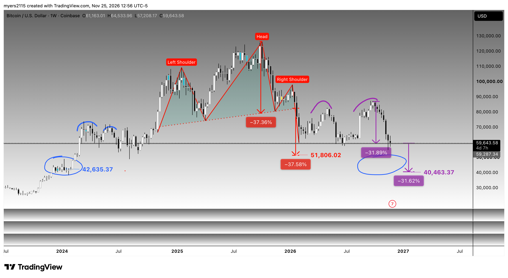
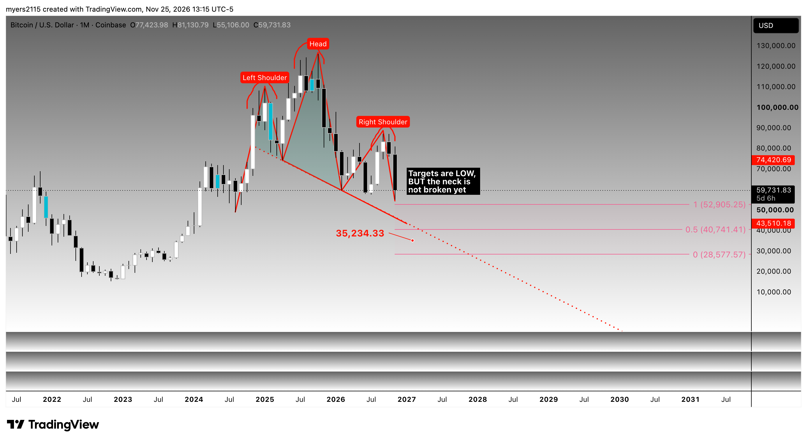
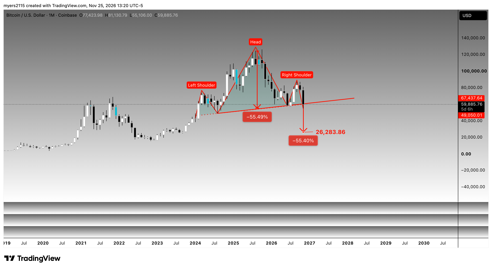
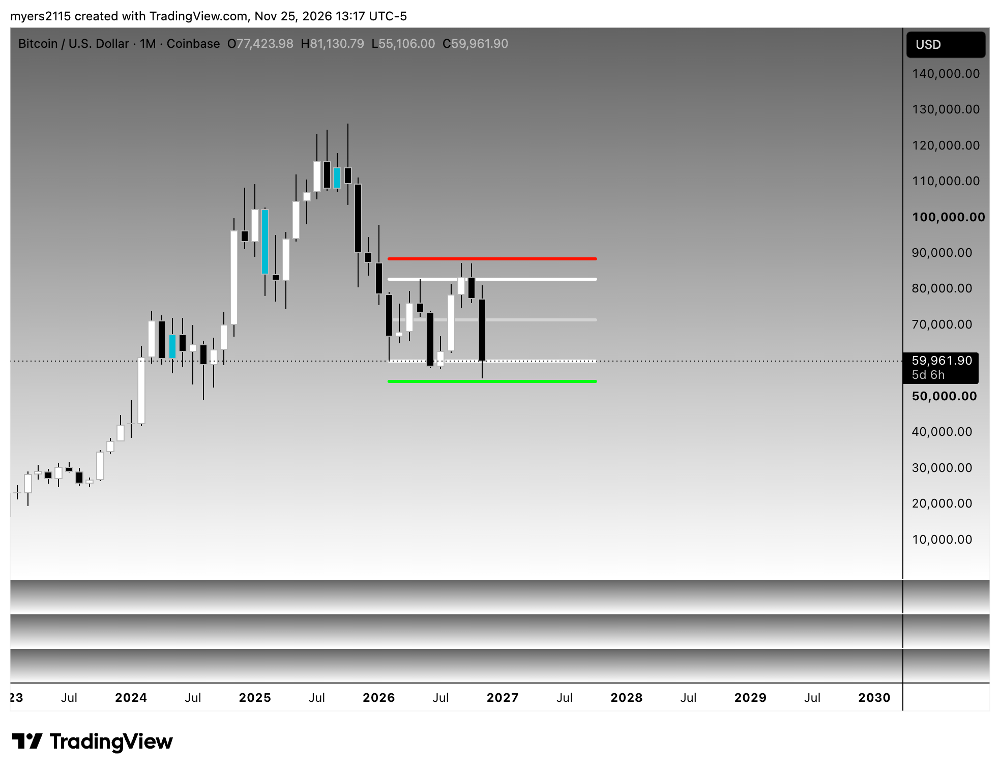
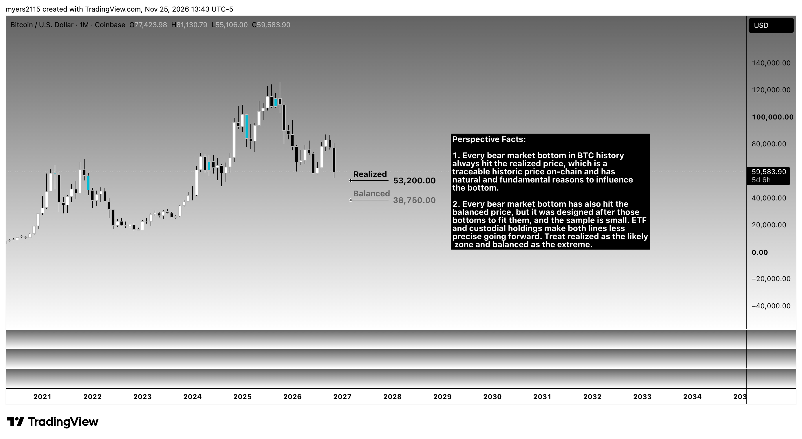
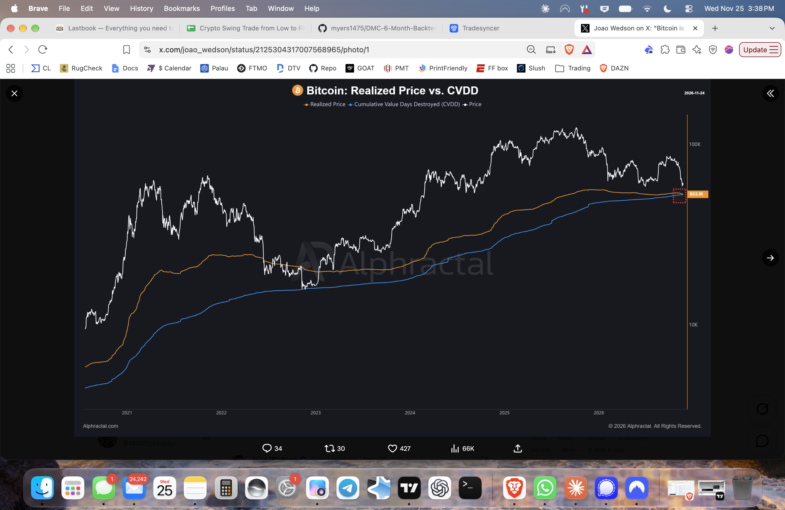
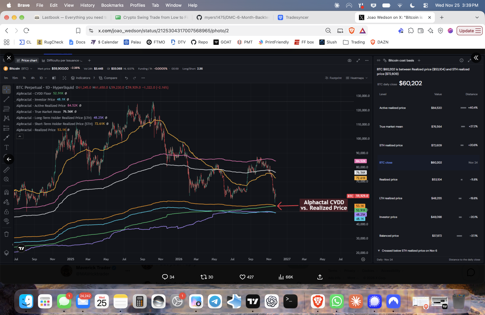
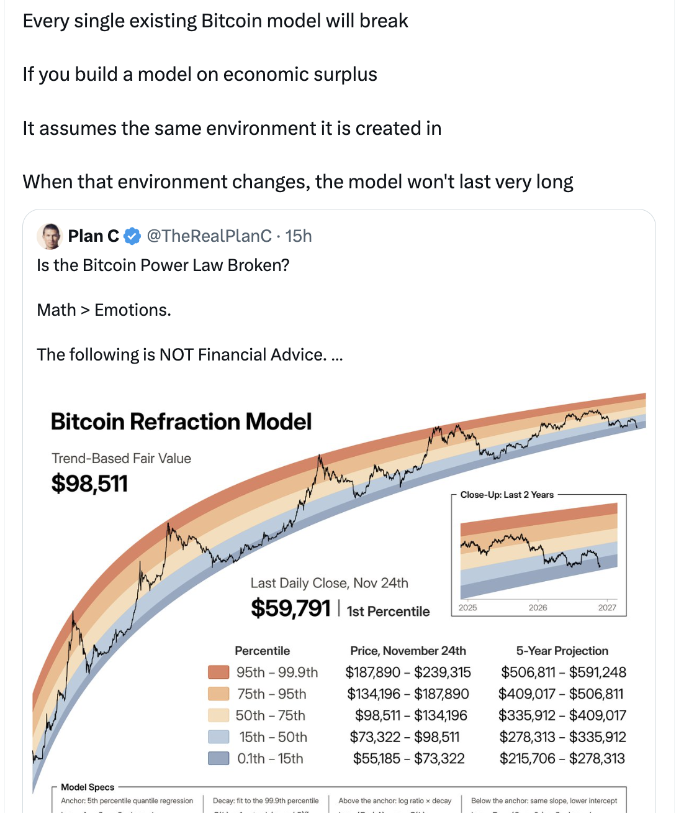

# Jay (Jayyseff) chat log: calls to check later

Matt asked to save his market conversations with Jay (PMO creator, ~$5M account, ~10 others in the chat)
to see how things turn out. Raw transcripts sit next to this file, one per date.

## 2026-11-25 (BTC ~$58-60K)  - raw: 2026-11-25_raw.txt

**Jay's calls**
- Short BTC open ("cookin"), but would like to see a bottom form here.
- If BTC loses $58K and doesn't quickly reclaim it -> "trapdoor" to $48-52K.
- A bear trap at 58 "would be sick"; thinks it's a dead cat, nonzero chance of a trap.
- Bearish catalysts: DXY ripping, new tariffs on China/EU/14 economies, no short-term bullish excitement.
- Gold daily printed a "yellow X".
- Technicals "at historic lows in some cases"; BTC + silver look great here; risk:reward justifies being long here as a swing trader ("be greedy when others are fearful").
- Leverage: 2x-5x prudent "with the right margin pool"; spot now = collateral to long the lows later; spot + 2x = "triple the return of spot".

**Matt's position / view**
- Agrees $48K is more likely than not; may grind rather than drop like a rock; NQ and gold look heavy too.
- Spot heavy now with a BTC + ETH ladder; no leverage on this local bottom; 1.5-2x leverage in the Q4-Q1 window once he feels good about the bottom.
- Disagrees with Jay that technicals support a bottom here. His evidence (Nov 24 2026):
  - Weekly "bottom line" (~0.47 x 52-week SMA) touched in every bottoming year (2015, 2018, 2022) + COVID; now ~$35.8K, falling to ~$30-34K by Q1. BTC never touched it outside those bottoms.
  - Monthly head & shoulders (LS Mar 2024, head Oct 2025, RS fall 2026), neckline ~$58-60K under test; measured move ~$26K (the 2021 H&S measured to $15.2K vs actual $15.46K).
  - Waiting for the November monthly close vs the neckline before reworking his buy ladder.

**Check later:** did $58K break and hold? Did it reach $48-52K? The bottom line ($30-35K)? The H&S target (~$26K)? Was 58 a bear trap?

**Matt's follow-up note (Nov 25):** even if Jay argues a monthly green dot, the monthly red counter-dot is real too
(not officially confirmed until the monthly close, ~5 days). Matt won't start going long before the November monthly close.
History: in the 2025 run-up Jay shorted from the first touch of ~$90K on overbought technicals and held the short for months
while BTC ran to $126K - the same oscillator-extreme lens, now pointed the other way. Part of why Matt stepped back from the group.

## Exhibit A (Nov 25 2026): BTC weekly symmetry, Matt's chart

Matt's case that ~$58K is not the bottom:
- Weekly H&S (LS Dec 2024, head Oct 2025, RS Dec 2025): measured -37.36% -> **$51,806**, never reached (low so far ~57K). This is the same zone as Jay's 48-52K trapdoor.
- Two rounded tops in 2026 (purple) mirror the two in 2024 (blue), both on the same ~$59.3K shelf (floor of the 2024 range, tested again now).
- Second hump fell -31.89% to the shelf; the same -31.62% below the shelf -> **$40,463**, on top of the late-2023/early-2024 base at **$42,635**.

Target ladder below (for the post-monthly-close buy-ladder rework):
| Level | Source |
|---|---|
| ~$51.8K | Weekly H&S unfinished target (Jay's 48-52K) |
| ~$40.5-42.6K | Symmetric measured move + 2023-24 base |
| ~$30-35K | Weekly "bottom line" (~0.47 x 52w SMA), touched every bottoming year |
| ~$26K | Monthly H&S measured move |

## Exhibit B (Nov 25 2026): BTC monthly "timeline megaphone", Matt's chart

Broadening (megaphone) pattern on the monthly, linear scale:
- Upper line through the cycle tops: Dec 2017 ($19,892), Nov 2021 ($69,000), Oct 2025 ($126,296) -> **Q4 2029 at ~$182,630**.
- Lower line through the cycle lows: Dec 2018 ($3,129), COVID 2020, Nov 2022 ($15,460) -> **Q4 2026 at ~$35,234** (horizontal ~$34,588); Q4 2030 next touch.
- Matt's drawn path: flush to ~$35K in Q4 2026 -> bounce -> "Black Swan 2027" retest of the lower line -> run through $126K -> ~$182.6K top in Q4 2029.
- Independent confluence: the lower line (~$35.2K) lands on the weekly bottom line (~$35.8K now, ~$30-34K by Q1). Two different methods, same zone.
- Timing: the lower line says the touch is due now (Q4 2026); price is ~$59.6K, ~70% above it.

## Exhibit C (Nov 25 2026): BTC monthly head & shoulders, option 1 (descending neckline), Matt's chart

- LS Dec 2024 (~$108K), head Oct 2025 ($126.3K), RS Oct 2026 (~$88K); neckline DESCENDING through the Apr 2025 (~$74K) and Feb 2026 (~$60K) lows, extended.
- Matt's note on chart: "Targets are LOW, BUT the neck is not broken yet."
- Measured-move levels: 1 = **$52,905**, 0.5 = **$40,741**, 0 (full) = **$28,577**. Neckline extension meets the megaphone lower line (~$35,234) around early 2027.
- Contrast with the Nov 24 rising-neckline version (neck ~$58-60K under test, target ~$26K): here the neckline slopes down, so the break level is lower (~low/mid $50Ks now) and keeps falling.
- Confluence with the other exhibits: $52.9K ~ weekly H&S $51.8K (Exhibit A); $40.7K ~ symmetry $40.5K / 2023-24 base $42.6K (Exhibit A); $28.6K ~ low end of bottom line (~$30K by Q1) / monthly H&S rising-neck target ~$26K.

## Exhibit D (Nov 25 2026): BTC monthly head & shoulders, option 2 (rising neckline), Matt's chart

- LS Mar 2024 (~$73K), head Oct 2025 ($126.3K), RS Oct 2026 (~$89K); neckline RISING from the Aug 2024 low (~$49K) through the mid-2026 lows (~$58K). Price is on it now (~$60K; Nov wick $55,106).
- Measured move -55.40% -> **$26,283.86**. Same pattern as the Nov 24 chart; the 2021 version measured to within 2% of the 2022 low.
- Trigger: a monthly close below the neckline (~$58-60K).

## Exhibit E (Nov 25 2026): BTC monthly "just a range" (Fibonacci range), Matt's chart

- The neutral read: price has ranged since Feb 2026. Levels (approx.): top ~$88.5K (red), ~$83K (white), mid ~$71.5K (grey), range low ~$60K (white, monthly closes), floor ~$54.5K (green, wicks; Nov low $55,106).
- Price sits at the bottom of the range. In range terms, that's the buy side, not a breakdown, until the floor goes.

### How the five exhibits fit together (decision points at the Nov monthly close)
- **Monthly close back above ~$60K:** the range (E) holds and the rising neckline (D) holds; range targets ~$71.5K mid, ~$83-88K top.
- **Monthly close below ~$58-60K:** H&S option 2 (D) triggers -> $26.3K target; first stops at $51.8-52.9K (A, C).
- **Loss of ~$54-55K:** the range floor (E) and the falling neckline of H&S option 1 (C) sit in the same zone; losing it confirms both bear options -> $40-43K (A, C 0.5), then $28-35K (bottom line, megaphone B, C full).

## Exhibit F (Nov 25 2026): realized and balanced price, "Perspective Facts", Matt's chart

- On-chain levels (Nov 24-25 2026): **realized price ~$53,200** (Glassnode), **balanced price ~$38,750** (Coinglass, Nov 20, falling ~2%/month).
- Every bear-market bottom (2015, 2018, COVID 2020, 2022) went below realized price (0.69x-0.88x at the lows; up to 301 days below) and reached balanced price.
- Why realized is the more reliable of the two: natural definition (aggregate cost basis) + a mechanism (break-even psychology; capitulation re-stamps coins low and pulls the line toward price). Balanced price was built after past bottoms to fit them (hindsight risk).
- ETF/custodial holdings ("measurement drift") make BOTH lines less precise going forward (balanced = realized minus transferred price), so treat realized as a zone, not a tick.
- Realized-price multiples at past lows mapped to today's $53.2K: Mar 2020 0.88x ~$46.8K, Jun 2022 0.84x ~$44.7K, Nov 2022 0.78x ~$41.5K, Dec 2018 0.69x ~$36.7K (realized usually sags during capitulation, so these could land slightly lower).
- Fit with the ladder: realized ~$53K = the $51.8-52.9K tier / $54-55K line in the sand; balanced ~$38.75K sits between the $40-43K tier and the $30-35K zone.

## Bottoming cases, ranked (Nov 25 2026, Claude's synthesis of Exhibits A-F + on-chain)
1. **$35-43K, centered ~$38-40K (~40%)**: realized x0.69-0.78 ($36.7-41.5K), balanced $38.75K, symmetry $40.5K, 2023-24 base $42.6K, H&S opt 1 0.5 $40.7K, megaphone ~$35.2K, Cowen late-$30Ks.
2. **$44-53K shallow (~30%)**: realized x0.84-0.88 ($44.7-46.8K), LTH cost basis $48.4K, weekly H&S $51.8K, H&S opt 1 $52.9K, Jay's 48-52K. Likeliest first stop.
3. **$26-33K deep (~20%)**: bottom line ~$31-33K by spring, H&S opt 1 full $28.6K, opt 2 $26.3K (2021 twin hit within 2%).
4. **Already in at $55.1K (~10%)**: range (E) holds; would break the record of every bottom going below realized price.
Timing: flush Q4 2026-Q1 2027, slow base + likely 2027 retest, rebound ~Mar-Jun 2027.
Updates: Nov close >$60K -> weight to 2 and 4; <$58K -> 1 and 3; losing $54-55K removes 4.
Percentages are judgment, not calculation.

## November-close scenarios (Nov 25 2026)
Baseline weights with both H&S necklines unbroken (H&S targets conditional): case 1 ~40%, case 2 ~30%, case 3 ~15%, case 4 ~15%.

**A. Close above the neckline (~$58-60K+).** Both necklines + range floor hold; a data point for E, not a verdict (December can still break). Matt's add: closing back above after trading below (Nov wick $55.1K) = relative strength / buyers defending; not a pump, but argues the eventual dump is shallower. Two straight closes above (Nov + Dec), even with wicks below, would make that case clearly. Realized ($53.2K) still untagged -> likely a delay, not a bottom (undercut slides into 2027). Weights: 1 ~30%, 2 ~35%, 3 ~10%, 4 ~25%. Plan: ladder as is, no leverage; watch a reclaim of the range mid (~$71.5K).

**B. Shallow break, close ~$55-58K.** Option 2 neck technically broken, but above the range floor and realized; not a Brandt wide-bodied breakout; bear-trap setup. December reclaim >$60K = failed breakdown (case 4 up); follow-through -> realized $53.2K / weekly H&S $51.8K. Weights: 1 ~40%, 2 ~35%, 3 ~15%, 4 ~10%. Plan: top rungs ($48-53K) in play; wait for December to confirm.

**C. Forceful break, wide-bodied close below ~$54K.** Option 2 confirmed, range floor gone, realized tagged/undercut, option 1 neck at hand. Flush legs historically 3-8 weeks: $51.8-53K fast, then $40-43K; megaphone ~$35K, bottom line ~$31-33K, H&S $28.6K/$26.3K active. Weights: 1 ~50%, 3 ~35%, 2 ~15%, 4 off. Plan: middle tiers fill fast; no leverage until the base (2022 took ~6 months break-to-low).

Common thread: realized price is the unfinished business; A/B/C mostly differ in WHEN it's tagged (2027 / December / immediately).

## Exhibit G (Nov 25 2026): CVDD meets realized price (Alphractal, via @joao_wedson / @arch_physicist on X)

- Realized price $53,104 vs CVDD ~$52,910: ~$194 apart, the first convergence ever. Past bottoms formed between them (realized above, CVDD as the floor; the 2022 low sat on CVDD).
- Cost-basis panel (Nov 24, BTC close $60,202): active realized $84,520; true market mean $76,564; STH realized $72,609 (crossed below Nov 6); realized $53,104; LTH realized $48,255; investor price $48,098; balanced $37,872.
- Why they meet: CVDD is cumulative (mostly only rises; old coins spent at high 2024-25 prices pushed it up); realized can fall (coins sold at a loss re-stamp lower). Partly mechanical.
- Conflict between two perfect records: every bottom went below realized (0.69-0.88x), and price never stayed meaningfully below CVDD. With the lines together, one record must break: bottom ~$50-53K (CVDD holds, shallowest-ever realized undercut) OR the first break of CVDD toward $35-43K.
- CVDD carries a calibration constant fit to past bottoms (same hindsight caution as balanced price), but $52.9K stacks with realized, weekly H&S $51.8K and H&S option 1 $52.9K.

**Updated weights (Nov 25, after Exhibit G):** case 1 ~35%, case 2 ~35%, case 3 ~15%, case 4 ~15%.
Scenarios: A (close above neck) 1 ~25 / 2 ~40 / 3 ~10 / 4 ~25; B (shallow break) 1 ~35 / 2 ~40 / 3 ~15 / 4 ~10; C (forceful break <$54K) 1 ~45 / 2 ~20 / 3 ~35 / 4 off.
Ladder note: only $2,750 of $12,363 BTC money sits in the $50-53K tier (rungs 1-2).

**Check later (added Nov 25):** regime change / secular bear test - a monthly close below CVDD (~$53K), then below balanced (~$38K), no reclaim by 2028, megaphone lower line failing = confirmed. Raised by an X commenter ("lots of firsts... welcome to the new norm"); his "first failed halving rally with no new ATH" was wrong (2024 halving -> $126K ATH Oct 2025). This view expects the opposite: shallower swings, higher floor.

## Exhibit H (Nov 25 2026): Plan C "Bitcoin Refraction Model" + "every model will break" quote-tweet

- Power-law-style percentile model: fair value $98,511; Nov 24 close $59,791 = 1st percentile; 0.1th percentile floor $55,185 (Nov wick $55,106 basically tagged it); 5-year projection $215.7K (lowest band) to $591K.
- Quote-tweet: models built in one environment break when it changes (same caution as balanced/CVDD calibration and ETF drift).
- Model floors stacked under price: classic power-law floor $67.7K (broken since Nov 15); refraction 0.1th pct $55.2K (tagged); realized $53.1K; CVDD $52.9K.
- $52-55K = where a family of historical models is tested at once. Hold -> models survive, supports case 2 (~$50-53K). Monthly close well below -> several break together (the commenter's thesis), deeper cases 1/3 in play.
- Plan C's $216K+ 2031 floor sits above Matt's own $175-200K 2029-top expectation: optimistic end, like Lilly.

## Exhibit I (Nov 25 2026): Ben Cowen, "The Weight of History" (video, summarized)
- A lower low in Q4 of a midterm year is normal; models now breaking were mostly over-optimistic/overfitted. The low could be in (odds up), but calling it goes against history.
- Realized price (~$53K): BTC went below it in every bear (2014-15; Nov 2018 -> Apr 2019; summer 2022 -> 2023). Balanced price next only if realized breaks.
- Counter to the ETF "measurement drift" caution: the "coins don't move" argument applied in 2014/2018/2022 too, and price still went below realized each time.
- Metals bottom first: gold Aug 2018 vs BTC Dec 2018; gold Sep 2022 vs BTC Nov 2022; gold Oct 2008 vs S&P Mar 2009. Gold/silver are capitulating now -> BTC low likely still ahead.
- No whale accumulation yet: whale activity score spiked ~0.8-0.9 at the 2014/2018/2022 lows; 2026 peaks ~0.4-0.5, now ~0.1. On-chain risk 0.165, past bottoms lower.
- Rate-hike analogs (after first hike; after a Sept midterm-year hike): BTC usually keeps selling off from here. Window of weakness 4-8 more weeks, into early 2027; if 2027 arrives with no new low, more open to the low being in.
- His strategy: DCA in the second half of the midterm year + buy risk levels (= Ladder A in spirit).

**Updated weights (after Exhibit I):** case 1 ~40%, case 2 ~35%, case 3 ~15%, case 4 ~10%.
Scenarios: A 1 ~30 / 2 ~40 / 3 ~10 / 4 ~20; B 1 ~40 / 2 ~40 / 3 ~15 / 4 ~5; C 1 ~50 / 2 ~15 / 3 ~35 / 4 off.
**Check later:** gold puts in its low (BTC's should follow); whale activity score spikes toward ~0.8.
