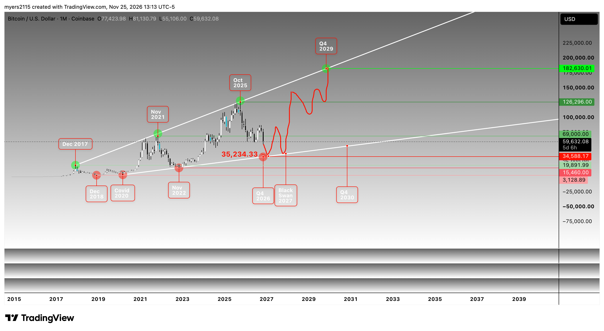

# Jay (Jayyseff) chat log: calls to check later

Matt asked to save his market conversations with Jay (PMO creator, ~$5M account, ~10 others in the chat)
to see how things turn out. Raw transcripts sit next to this file, one per date.

## 2026-11-25 (BTC ~$58-60K)  - raw: 2026-11-25_raw.txt

**Jay's calls**
- Short BTC open ("cookin"), but would like to see a bottom form here.
- If BTC loses $58K and doesn't quickly reclaim it -> "trapdoor" to $48-52K.
- A bear trap at 58 "would be sick"; thinks it's a dead cat, nonzero chance of a trap.
- Bearish catalysts: DXY ripping, new tariffs on China/EU/14 economies, no short-term bullish excitement.
- Gold daily printed a "yellow X".
- Technicals "at historic lows in some cases"; BTC + silver look great here; risk:reward justifies being long here as a swing trader ("be greedy when others are fearful").
- Leverage: 2x-5x prudent "with the right margin pool"; spot now = collateral to long the lows later; spot + 2x = "triple the return of spot".

**Matt's position / view**
- Agrees $48K is more likely than not; may grind rather than drop like a rock; NQ and gold look heavy too.
- Spot heavy now with a BTC + ETH ladder; no leverage on this local bottom; 1.5-2x leverage in the Q4-Q1 window once he feels good about the bottom.
- Disagrees with Jay that technicals support a bottom here. His evidence (Nov 24 2026):
  - Weekly "bottom line" (~0.47 x 52-week SMA) touched in every bottoming year (2015, 2018, 2022) + COVID; now ~$35.8K, falling to ~$30-34K by Q1. BTC never touched it outside those bottoms.
  - Monthly head & shoulders (LS Mar 2024, head Oct 2025, RS fall 2026), neckline ~$58-60K under test; measured move ~$26K (the 2021 H&S measured to $15.2K vs actual $15.46K).
  - Waiting for the November monthly close vs the neckline before reworking his buy ladder.

**Check later:** did $58K break and hold? Did it reach $48-52K? The bottom line ($30-35K)? The H&S target (~$26K)? Was 58 a bear trap?

**Matt's follow-up note (Nov 25):** even if Jay argues a monthly green dot, the monthly red counter-dot is real too
(not officially confirmed until the monthly close, ~5 days). Matt won't start going long before the November monthly close.
History: in the 2025 run-up Jay shorted from the first touch of ~$90K on overbought technicals and held the short for months
while BTC ran to $126K - the same oscillator-extreme lens, now pointed the other way. Part of why Matt stepped back from the group.

## Exhibit A (Nov 25 2026): BTC weekly symmetry, Matt's chart

Matt's case that ~$58K is not the bottom:
- Weekly H&S (LS Dec 2024, head Oct 2025, RS Dec 2025): measured -37.36% -> **$51,806**, never reached (low so far ~57K). This is the same zone as Jay's 48-52K trapdoor.
- Two rounded tops in 2026 (purple) mirror the two in 2024 (blue), both on the same ~$59.3K shelf (floor of the 2024 range, tested again now).
- Second hump fell -31.89% to the shelf; the same -31.62% below the shelf -> **$40,463**, on top of the late-2023/early-2024 base at **$42,635**.

Target ladder below (for the post-monthly-close buy-ladder rework):
| Level | Source |
|---|---|
| ~$51.8K | Weekly H&S unfinished target (Jay's 48-52K) |
| ~$40.5-42.6K | Symmetric measured move + 2023-24 base |
| ~$30-35K | Weekly "bottom line" (~0.47 x 52w SMA), touched every bottoming year |
| ~$26K | Monthly H&S measured move |

## Exhibit B (Nov 25 2026): BTC monthly "timeline megaphone", Matt's chart

Broadening (megaphone) pattern on the monthly, linear scale:
- Upper line through the cycle tops: Dec 2017 ($19,892), Nov 2021 ($69,000), Oct 2025 ($126,296) -> **Q4 2029 at ~$182,630**.
- Lower line through the cycle lows: Dec 2018 ($3,129), COVID 2020, Nov 2022 ($15,460) -> **Q4 2026 at ~$35,234** (horizontal ~$34,588); Q4 2030 next touch.
- Matt's drawn path: flush to ~$35K in Q4 2026 -> bounce -> "Black Swan 2027" retest of the lower line -> run through $126K -> ~$182.6K top in Q4 2029.
- Independent confluence: the lower line (~$35.2K) lands on the weekly bottom line (~$35.8K now, ~$30-34K by Q1). Two different methods, same zone.
- Timing: the lower line says the touch is due now (Q4 2026); price is ~$59.6K, ~70% above it.
